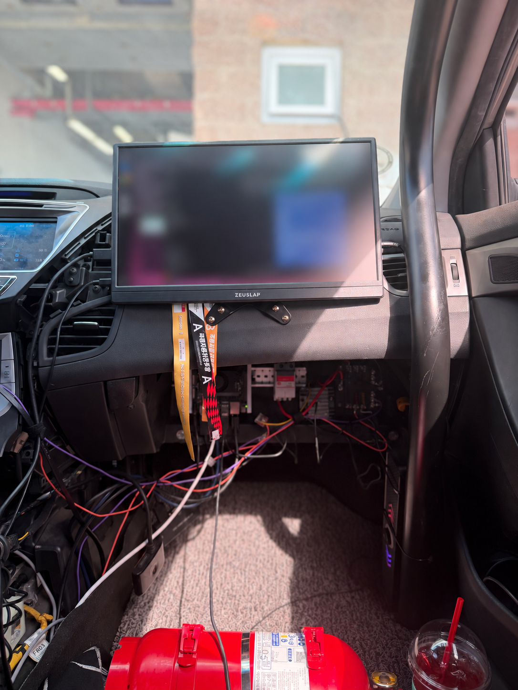
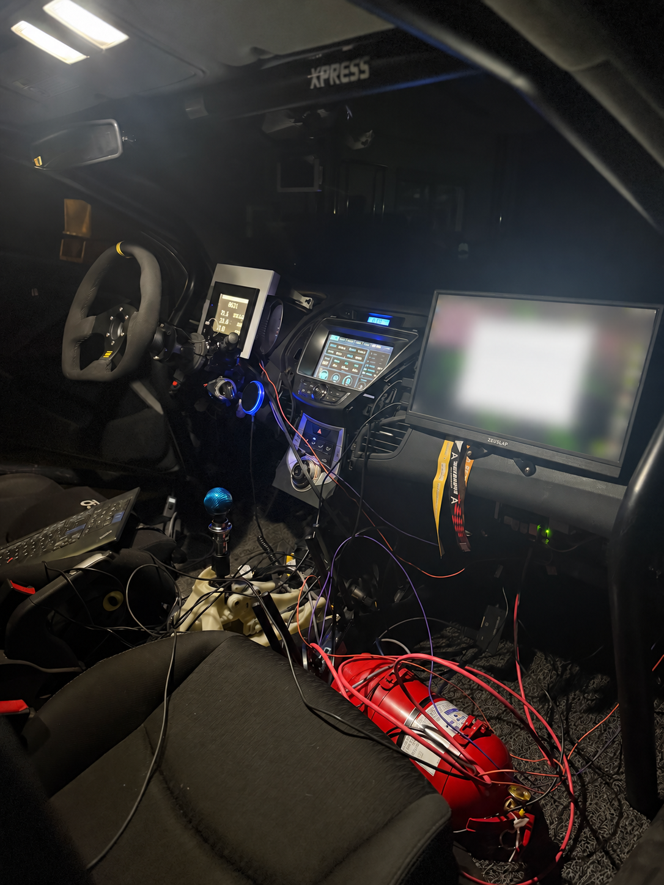
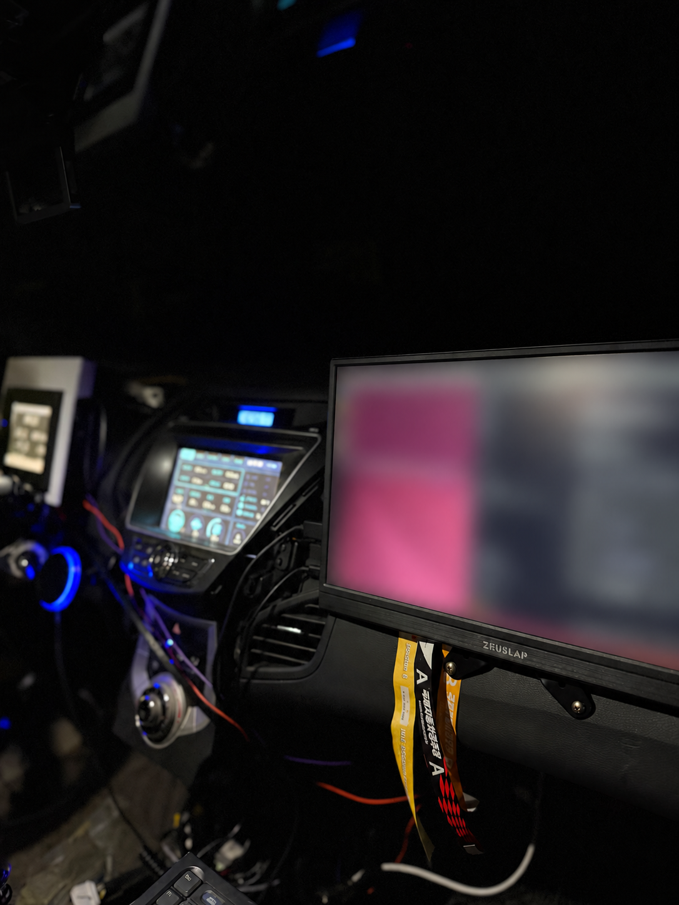
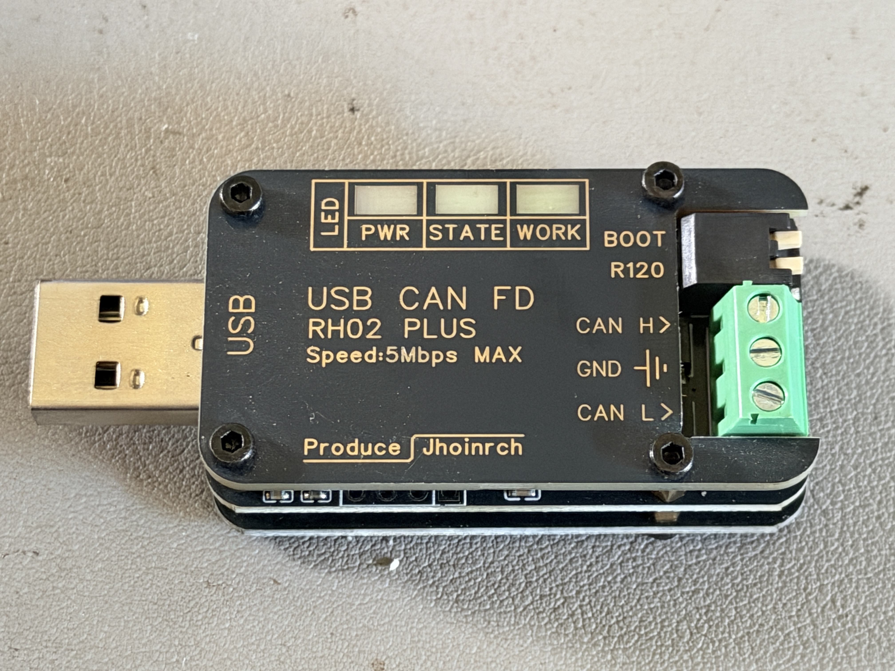
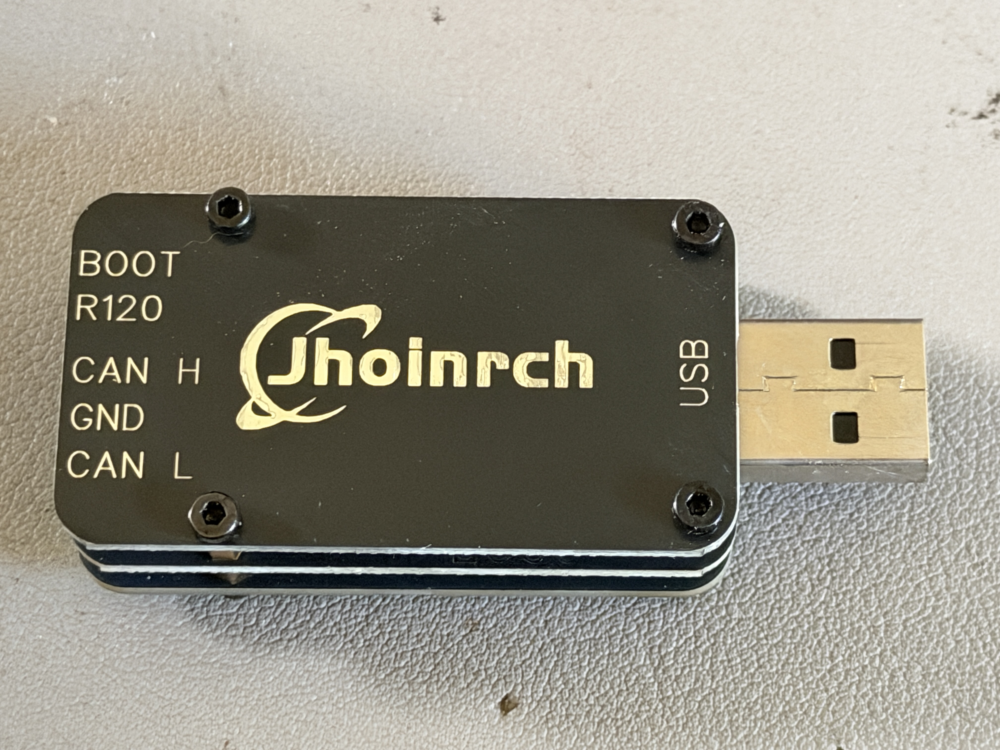
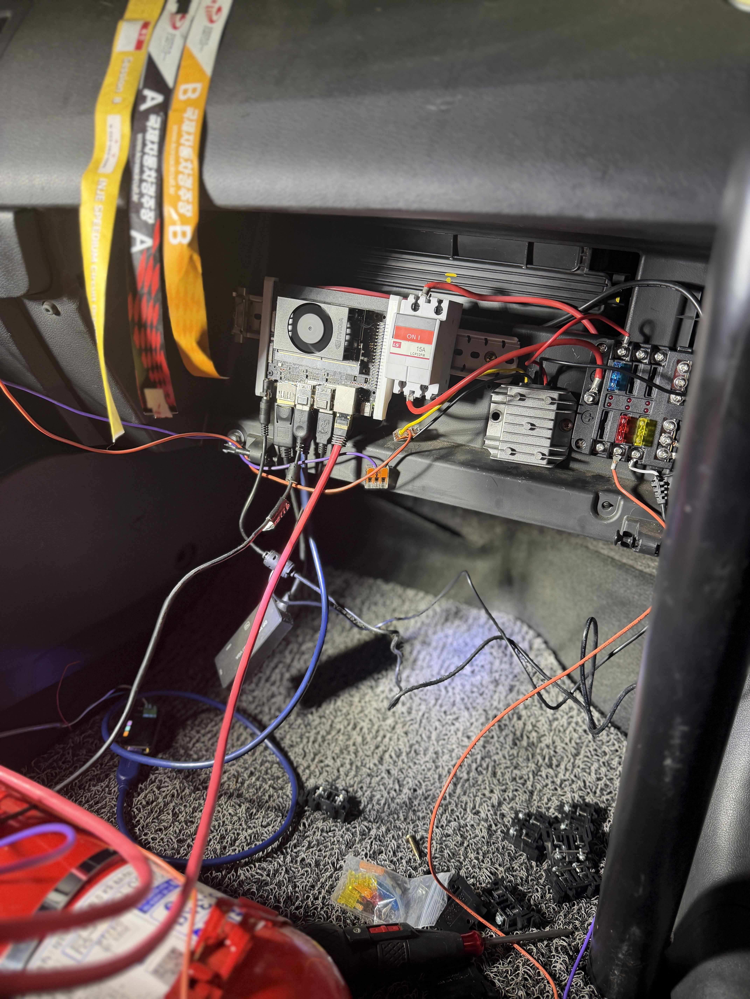

# AI Race Engineer & Data Logger (JEV)

주행 데이터 분석과 레이스 코칭을 위한 오프라인 연구 프로토타입입니다. 현재 공개 재현본은 합성 데이터 분석·리포트만 제공하며, 실제 차량 데이터 로깅이나 실시간 차량 연동 기능은 포함하지 않습니다.

이 저장소는 운영 장치와 분리한 최소 재현본입니다. 모든 포함 데이터는 수학식으로 만든 합성 데이터입니다. 실제 주행 CSV, GPS 위치, 원본 영상, 음성 파일, 장치 설정과 계정 정보는 포함하지 않습니다.

## 1분 실행

Python 3.10 이상이 필요합니다. 분석과 테스트에 외부 Python 패키지, GPU, 인터넷, API 키가 필요하지 않습니다.

```console
python -m jev demo --output build/demo
python -m unittest discover -s tests -v
```

`build/demo/index.html`을 브라우저로 열면 합성 랩 A(파랑)와 합성 랩 B(주황)의 속도·가속페달·조향·누적 시간 차이 그래프, 섹터 표와 코너 비교를 확인할 수 있습니다. 두 랩은 이미 동일한 합성 경로 거리로 정렬되어 있습니다. GPS 투영이나 영상 동기화 기능을 수행하는 예제가 아닙니다.

`build/demo/coach_events.json`에는 랩 완료 및 섹터 통과 코칭 문장이 저장됩니다. 오디오 재생·외부 음성 합성은 수행하지 않습니다. 장치나 CAN에 접근하는 명령도 없습니다.

선택적 개발용 설치:

```console
python -m pip install -e .
jev-offline demo --output build/demo
```

설치 없이 첫 번째 방식으로 충분합니다. `.env.example`은 구성 예시이며 프로그램이 자동으로 읽지 않습니다. 실행 설정은 CLI 인자로 지정합니다.

## 포함 기능

| 기능 | 공개 재현본 | 설명 |
|---|---|---|
| 동적 랩 코칭 분류 | 구현 | 이번 랩 이전의 베스트를 기준으로 최초·베스트·근접·보통·큰 차이 분류 |
| 섹터 이벤트 | 구현 | 같은 랩의 1→2·2→3 전환만 통과 이벤트 생성 |
| 데이터 검증 | 구현 | NaN/무한대·범위·중복 거리·시간 역전·누락 검증 |
| 정렬된 두 랩 분석 | 구현 | 공통 거리 범위 내 선형 보간, 외삽 금지 |
| 섹터·구간 시간 | 구현 | 사용자가 지정한 거리 경계 사이의 시간 비교 |
| 코너 속도 요약 | 구현 | 진입 −70m / 최저 ±40m / 탈출 +80m의 **분석 창** |
| HTML/SVG 리포트 | 구현 | 파랑·주황 실선, 표와 한국어 관찰 문장, 외부 라이브러리 없음 |
| 실시간 파일 감시·운영 음성 | 미포함 | 기존 장치의 별도 프로토타입 범위 |
| GPS 경로 투영·영상 제작 | 미포함 | 비공개 기록으로 별도 검증한 연구 산출물 |


공개 코어는 기존 장치의 분류 원리를 참고해 새로 분리했습니다. 운영 파일의 복사본이나 배포 패키지가 아닙니다. 이 재현본에서 추가한 엄격한 입력 검증과 상태 리셋 처리를 운영 장치에 적용했다는 뜻도 아닙니다.

## 입력과 실행 예

```console
python -m jev replay --input data/synthetic/lap_states.jsonl --output build/events.json
python -m jev analyze --input data/synthetic/telemetry.csv --spec data/synthetic/analysis_spec.json --reference A --candidate B --output build/custom
```

- CSV 열: `lap,distance_m,elapsed_s,speed_kmh,throttle_pct,steering_deg`
- `distance_m`은 두 랩에서 같은 물리적 경로 위치를 의미해야 합니다. 각각의 누적 이동거리를 그대로 같은 경로로 취급하면 결과가 달라질 수 있습니다.
- 코너 번호와 섹터 경계는 `analysis_spec.json`의 합성 예시입니다. 실제 서킷의 공식 번호·경계가 아닙니다.
- 서로 다른 랩을 비교할 때 겹치지 않는 구간이나 누락값을 추정해 채우지 않습니다.

자세한 계약은 [입력 형식](docs/DATA_FORMAT.md), 분류와 수치 정의는 [분석 방법](docs/METHODS.md)을 확인하세요.

## 해석 범위

속도가 높았다는 관찰만으로 랩타임 개선의 원인을 확정하지 않습니다. 교통, 타이어, 기어, 제동, 노면, 운전자 의도를 이 예제로 검증할 수 없습니다. 분석 창의 최저 속도는 코너 전체 최저 속도나 공식 에이펙스 속도와 다릅니다. 합성 결과는 성능 향상이나 실차 안전성을 입증하지 않습니다.

주행 중 지속 해설의 주의 분산과 표시 허용 범위는 차량 플랫폼 정책에 따라 별도로 설계해야 합니다. 이 공개본은 정차 후 검토용이며 운전 조작을 지시하지 않습니다.

## 구조

```text
jev/coaching.py        검증된 상태 → 한국어 이벤트
jev/analysis.py        같은 경로 거리 → 랩·섹터·코너 수치
jev/reporting.py       수치 → 자체 포함 HTML/SVG
jev/adapters/          향후 입력 어댑터 확장 위치
data/synthetic/        합성 CSV·상태·분석 기준·생성 기록
tests/                경계값·잘못된 입력·수치 기준·CLI 검증
docs/                 입력 형식, 분석 방법, 구현·공개 범위
```

## 참고 차량 세팅

- 차량: 2012 현대 아반떼 MD 1.6 GDI 자연흡기, 전륜구동
- 타이어: 넥센 SUR4G, 225/45R17
- 공기압: 촬영 당시 냉간 앞·뒤 27 psi
- 서스펜션: 네오테크 경기용 코일오버, 앞·뒤 감쇠 조절 최대 강도
- 얼라인먼트: 앞 캠버 약 −4°; 뒤는 토션빔으로 사용자가 조정할 수 없는 구성
- 실제 토 수치와 스프링 레이트는 확인되지 않음

이 값은 사용자가 제공한 촬영 당시 세팅 메모입니다. 비교 결과만으로 세팅 효과나 권장 얼라인먼트를 확정하지 않습니다.

### 데이터 수집 장비 메모

- 컴퓨팅 장치: Jetson Orin Nano Super
- 차량 데이터 인터페이스: USB-CAN 어댑터 (제조사·모델 미확인)
- 위치 데이터: GPS 수신/기록 장치 (제조사·모델 미확인)

위 장비 메모는 시스템 구성에 대한 설명입니다. 이 저장소에는 실제 CAN 기록이나 GPS 위치·경로가 없고, 분석 예제는 합성 데이터만 사용합니다.

### YouTube 영상 | YouTube Videos

**한국어**  
아래 영상은 차량 온보드 장면과 GPS·주행 로그를 활용한 랩 비교 시연물입니다. 현재 이 저장소의 오프라인 재현본에는 실제 차량 데이터나 영상 분석·동기화 기능이 포함되지 않으며, 예제 분석에는 합성 데이터만 사용합니다.

- [유튜브 영상 1](https://youtu.be/8iogd280mPg)
- [유튜브 영상 2](https://youtu.be/J-jpW8rC6g0)

**English**  
The videos below demonstrate lap comparisons using onboard footage, GPS traces, and driving logs. This repository's offline reproduction does not include real vehicle data or video-analysis/synchronization features; its runnable examples use synthetic data only.

- [YouTube video 1](https://youtu.be/8iogd280mPg)
- [YouTube video 2](https://youtu.be/J-jpW8rC6g0)

### 설치 장비 사진 및 시연 영상

- [차량 내 JEV 시연 영상 보기 (YouTube)](https://youtu.be/nUxbhtMYJn8)

아래 사진은 차량 내 컴퓨팅 장치와 데이터 수집 장비의 설치 모습을 보여줍니다. 위치정보가 담긴 EXIF 메타데이터를 제거했고, 모니터 화면은 접속정보 보호를 위해 흐림 처리했습니다.













## 저장소 상태

이 저장소는 현재 비공개입니다. 포함 자료의 사용·재배포 권한을 확인한 뒤 별도로 공개 여부를 결정하세요. 라이선스는 정하지 않았습니다. 자세한 내용은 [라이선스 상태](LICENSE_STATUS.md)를 확인하세요.

## 연락처

프로젝트 문의: [garamyun@faunicorn.com](mailto:garamyun@faunicorn.com)
